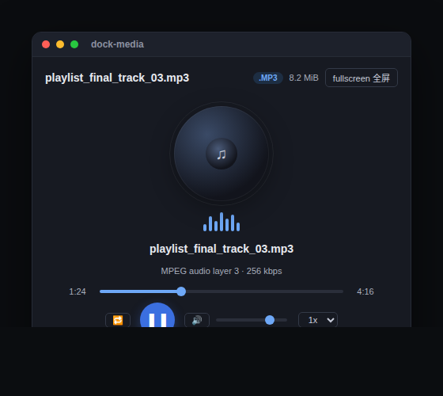
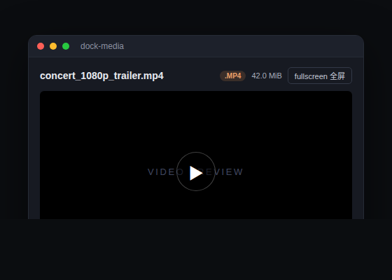

# dock-media

[中文](README.md)

> **The best media player plugin in the DSH ecosystem — no contest.** Pure audio (MP3, WAV, FLAC, M4A, ...) gets a proper music player; video (MP4, WebM, MOV, ...) gets fullscreen playback. Instead of loading a whole file as base64, dock-media **streams** bytes over HTTP Range (206 Partial Content), so large files open instantly and seeking stays smooth.

Media player plugin of the dock family: registers the `media` file viewer for audio + video extensions against the dock-files file domain, plus the matching editor-area view; it streams media bytes through its own `/dock-media/source` host route (Range-aware, so the `<audio>` / `<video>` element can seek and stream progressively).

## Preview




## Features

- **Dual-mode playback**: pure audio (MP3/WAV/OGG/OPUS/FLAC/AAC/M4A/WebA...) opens a **music player** (spinning record + equalizer animation + custom transport); video (MP4/M4V/WebM/MOV/MKV/OGV/AVI/TS/3GP...) opens a **native fullscreen-capable video player**.
- **Streaming, not buffering**: unlike dock-images (whole-file base64), dock-media streams the file bytes via `/dock-media/source` with `Range` → `206 Partial Content` + `Accept-Ranges: bytes`. Large files open instantly, the seek bar works, and the whole file is never loaded into memory.
- **Fullscreen**: both video and the music player support one-click fullscreen (browser Fullscreen API on the container; falls back to a fixed `inset:0` overlay when unavailable). In fullscreen the header becomes a translucent floating bar for an immersive view.
- **Music player**: play/pause, drag to seek, current/total time, volume, mute, playback speed (0.5x–2x), repeat-one; the spinning record and equalizer animate with playback state.
- **Format badge & size**: `/dock-media/probe` returns file size and media kind, so the header shows the `.MP3`/`.MP4` badge and size immediately.
- **Graceful degradation**: container/codec combos the browser cannot decode (e.g. AVI, FLV, WMV, MPG, MIDI, WMA) show a clear notice instead of a black box or endless spinner.
- **Safe rendering**: media is handed to the native `<audio>`/`<video>` element via `src`; no innerHTML / dangerous DOM injection.

### Supported formats

| Category | Extensions |
| --- | --- |
| Audio | mp3, wav, ogg, oga, opus, flac, aac, m4a, weba, wma, mid, midi |
| Video | mp4, m4v, webm, mov, mkv, ogv, avi, mpg, mpeg, flv, wmv, 3gp |

> Note: whether the browser plays a file is decided by the **codec**, not the container/extension. Mainstream encodings — `mp4` (H.264), `webm` (VP8/VP9/AV1), `mp3`, `flac`, `ogg` — essentially always play; old containers such as `avi`, `flv`, `wmv`, `mpg` are **not decodable** in most browsers and dock-media will tell you honestly (use a system player for those). **`.ts` belongs to TypeScript source (handled by dock-editor); dock-media does not claim it.**

## Dependencies

| Dependency | Type | Notes |
| --- | --- | --- |
| [dock](https://github.com/AKS1st/dock) >= 0.1.0 | peer (required) | workbench shell: the editor-area view, floating windows and `ctx.workbench` come from it |
| [dock-files](https://github.com/AKS1st/dock-files) >= 0.1.0 | peer (required) | file-domain service: dock-media is dispatched as the `media` viewer |
| DSH Web environment | runtime | required; client platform is Web |
| `cordis` ^4.0.0-rc.7 | peer | plugin framework (ships with DSH) |
| `react` ^18.2.0 | peer (optional) | needed for client rendering; without it the viewer UI does not activate |

**Optional companions**: coexists with other viewers such as `dock-editor`, `dock-markdown` and `dock-images`, each taking over its own extensions.

## Install

Requires `dock` and `dock-files`:

```sh
dsh plugin add github:AKS1st/dock
dsh plugin add github:AKS1st/dock-files
dsh plugin add github:AKS1st/dock-media
```

## Security

The `/dock-media` route only accepts requests from trusted origins (loopback / trustedHosts plus same-origin check); `source` is GET (streaming) and `probe` is POST (metadata). Read paths only need to be absolute — they are not confined to the session workspace, because the conversation context can mention media outside it (e.g. `~/Music/...`, `~/.dsh/skills/...`) and the player opens them; paths are read-only, never written back.

## License

MIT
