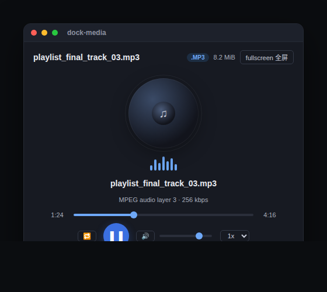
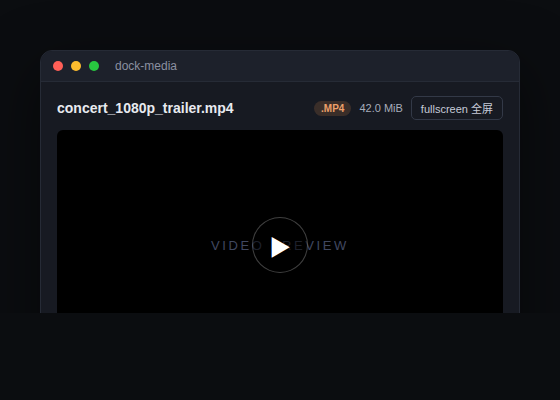

# dock-media

[English](README.en.md)

> **DSH 生态中最好用的媒体播放插件 —— 没有之一。** MP3、WAV、FLAC、M4A 等纯音频用音乐播放器呈现；MP4、WebM、MOV 等视频支持全屏播放。播放不走整文件 base64，而是**流式（HTTP Range / 206 分片）**读取，大文件也能秒开、随时拖动进度条。

dock 系列的媒体播放插件：为 dock-files 文件域注册 `media` 文件查看器（音频 + 视频扩展名）与对应的编辑器区视图，通过自己的 `/dock-media/source` 主机路由流式传输媒体字节（支持 Range 分段请求，便于 `<audio>` / `<video>` 元素边看边下、拖拽定位）。

## 效果预览




## 功能

- **双模式播放**：纯音频（MP3/WAV/OGG/OPUS/FLAC/AAC/M4A/WebA…）进入**音乐播放器**（旋转唱片 + 均衡器动画 + 自定义走带条）；视频（MP4/M4V/WebM/MOV/MKV/OGV/AVI/TS/3GP…）进入**原生视频播放器**，带全屏播放。
- **流式传输**：不同于 dock-images 的整文件 base64，dock-media 通过 `/dock-media/source` 直接流式返回文件字节，支持 HTTP `Range` → `206 Partial Content` + `Accept-Ranges: bytes`，因此大文件也能秒开、拖拽进度条、边下边播，**不会把整个文件读进内存**。
- **全屏**：视频与音乐播放器都支持一键全屏（浏览器 Fullscreen API，容器全屏；不可用时退化为固定 `inset:0` 覆盖层）。全屏时头部变为半透明悬浮条，沉浸式观看。
- **音乐播放器**：播放/暂停、拖动进度、当前/总时长、音量、静音、播放速度（0.5x–2x）、单曲循环；旋转唱片 + 均衡器随播放状态动效。
- **格式徽章与大小**：`/dock-media/probe` 返回文件大小与媒体种类，头部实时显示 `.MP3`/`.MP4` 徽章与大小。
- **优雅降级**：浏览器无法解码的封装/编码（如 AVI、FLV、WMV、MPG、MIDI、WMA）会给出提示，而不是黑屏/转圈。
- **安全渲染**：媒体通过 `src` 交给原生 `<audio>`/`<video>` 解码，绝不做 innerHTML / 危险 DOM 注入。

### 支持格式

| 类别 | 扩展名 |
| --- | --- |
| 音频 | mp3, wav, ogg, oga, opus, flac, aac, m4a, weba, wma, mid, midi |
| 视频 | mp4, m4v, webm, mov, mkv, ogv, avi, mpg, mpeg, flv, wmv, 3gp |

> 说明：浏览器能否解码头由**解码器**决定，与容器/扩展名无必然关系。`mp4`(H.264)、`webm`(VP8/VP9/AV1)、`mp3`、`flac`、`ogg` 等主流编码基本都能播；`avi`、`flv`、`wmv`、`mpg` 等旧封装在多数浏览器里**无法解码**，dock-media 会如实提示（建议用系统播放器）。**`.ts` 归 TypeScript 源码（由 dock-editor 处理），dock-media 不接管。**

## 依赖

| 依赖 | 类型 | 说明 |
| --- | --- | --- |
| [dock](https://github.com/AKS1st/dock) >= 0.1.0 | peer（必需） | 工作台外壳：编辑器区视图、浮窗、`ctx.workbench` 由它提供 |
| [dock-files](https://github.com/AKS1st/dock-files) >= 0.1.0 | peer（必需） | 文件域服务：dock-media 作为 `media` 查看器被分发打开 |
| DSH Web 环境 | 运行时 | 必需，客户端平台为 Web |
| `cordis` ^4.0.0-rc.7 | peer | 插件框架（DSH 自带） |
| `react` ^18.2.0 | peer（可选） | 客户端渲染需要；未提供时查看器 UI 不激活 |

**可选搭档**：与 `dock-editor`、`dock-markdown`、`dock-images` 等查看器共存，按扩展名各自接管对应文件类型。

## 安装

需要 `dock` 与 `dock-files`：

推荐从 npm registry 安装：

```sh
dsh plugin --profile web add dock-base
dsh plugin --profile web add dock-files
dsh plugin --profile web add dock-media
```

或通过 GitHub 安装（备选）：

```sh
dsh plugin --profile web add github:AKS1st/dock
dsh plugin --profile web add github:AKS1st/dock-files
dsh plugin --profile web add github:AKS1st/dock-media
```

## 安全

`/dock-media` 路由只接受受信任来源（回环地址 / trustedHosts + 同源检查）的请求；`source` 为 GET（流式），`probe` 为 POST（元数据）。读取路径只要求是绝对路径、不限定会话工作区——对话上下文可能提及工作区外的媒体（如 `~/Music/...`、`~/.dsh/skills/...`），播放器可打开它们；路径只读、绝不写回。

## License

MIT
